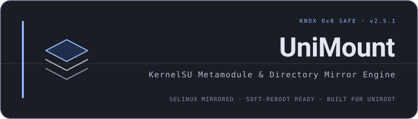

# UniMount — KernelSU Metamodule

<div align="center">



<br/>


[](./LICENSE)

[](https://github.com/HazY-Codes/Unimount/releases/latest)
[](https://github.com/HazY-Codes/Unimount/commits)
[](https://github.com/HazY-Codes/Unimount/commits)
[](https://github.com/HazY-Codes/Unimount/releases)

</div>

---

## About

**UniMount** (`v2.5.1`) is a KernelSU metamodule based on **NanoMount**, written for **UniRoot** and compatible temporary/late-load or systemless root environments (KernelSU, KernelSU-Next, APatch, DFRoot, GhostLock).

It applies module files using read-only bind mounts and minimal-ancestor directory mirrors under `/data/adb/unimount/mirror`. Physical partitions are never remounted read-write, and neither kernel `OverlayFS` nor `tmpfs` overlays are required, keeping Knox `0x0` intact across soft reboots.

---

## How It Works

- **Two-Pass Mount Engine (`metamount.sh`):**
  - **Pass 1 (`DIR_MIRROR_INJECT=1`):** Detects new files, new directories, and symlink replacements, resolves the deepest existing real directory ancestor, and builds a merged mirror under `/data/adb/unimount/mirror/merged`. Untouched sibling subdirectories are bind-mounted read-only onto stub directories; modified subtrees merge module files with cloned or ancestor-inherited SELinux labels and POSIX permissions.
  - **Pass 2 (`FILE_BIND`):** Bind-mounts remaining existing-file overrides read-only (`remount,ro,bind`).
  - **SAR Symlink Routing:** Routes `$MOD/system/{vendor,product,system_ext,odm}` to real partition roots (`/{vendor,product,system_ext,odm}`) when `/system/<subpart>` is a symlink.
- **Active Mount Ledger & Detach (`metamount.sh --unmount-all`):**
  - Mirrors active `DIR_MIRROR` and `FILE_BIND` entries between `/dev/unimount_active_mounts` (RAM, cleared on cold boot) and `/data/adb/unimount/active_mounts.list`.
  - Detaches all UniMount-tracked mirrors and file binds immediately via `--unmount-all` or the WebUI confirmation dialog without rebooting.
- **Safety Guards:**
  - **Single-Metamodule Check:** `customize.sh` aborts if another active `metamodule=1` package is installed or owns `/data/adb/metamodule`, and warns on standalone mount engines.
  - **Safe Mode & Bootloop Guard (`BOOTLOOP_GUARD=1`):** Skips mounts in Android/KSU Safe Mode or after 2 consecutive incomplete boots. Resets via `boot-completed.sh`, a detached 25-second post-mount `system_server` check for late-load root, or the WebUI.
  - **Critical Path & Sub-Mount Protection (`PROTECT_CRITICAL_PATHS=1`):** Blocks mounts over `/system/bin/init`, `/system/bin/linker*`, `/system/bin/vold`, `*servicemanager`, SELinux policy directories (`*/etc/selinux/*`), partition roots, `/system/apex/*`, and directories with active non-UniMount child mounts.
  - **Fail-Closed SELinux Mirroring (`SELINUX_MIRROR=1`):** Mirrors target labels (`chcon` / `chcon -h`) and POSIX mode/UID/GID before mounting; skips targets whose labels cannot be applied while SELinux is `Enforcing`.
- **Multi-Partition Support:** Scans `system`, `vendor`, `product`, `system_ext`, `odm`, `prism`, and `optics`, with `auto` or `manual` (`modules.txt`) mode and automatic skipping of Zygisk/service-only modules.
- **Offline KSU WebUI (`webroot/`):** Flat slate/periwinkle utility UI supporting Follow System / Light / Dark themes plus optional KernelSU Monet dynamic color, live Status telemetry, Behaviour toggles (`config.conf`), Module whitelist/skip controls, `/data/adb` orphan inspection (`known_dirs.json`), and Diagnostics logs (`mount.log`, active ledger, `/proc/mounts`).

---

## Releases & Commits

See [CHANGELOG.md](./CHANGELOG.md) for full release notes, commit history, and artifact SHA-256 checksums.

| Release | `versionCode` | Commit | Package | Highlight |
| :--- | :---: | :---: | :--- | :--- |
| [v2.5.0](https://github.com/HazY-Codes/Unimount/releases/tag/v2.5.0) *(latest)* | `250` | [`630c741`](https://github.com/HazY-Codes/Unimount/commit/630c7419acad6b800eaa46c181d02e7b65b1b8cf) | [UniMount-v2.5.0-KSU-WebUI.zip](https://github.com/HazY-Codes/Unimount/releases/download/v2.5.0/UniMount-v2.5.0-KSU-WebUI.zip) | Two-pass mirror engine, RAM mount ledger, `--unmount-all`, GPL-3.0 |
| [v2.4.4](https://github.com/HazY-Codes/Unimount/releases/tag/v2.4.4) | `244` | [`f5cb122`](https://github.com/HazY-Codes/Unimount/commit/f5cb1220bb910c307b5d1c478e84f0ae666f2167) | [UniMount-v2.4.4-KSU-WebUI.zip](https://github.com/HazY-Codes/Unimount/releases/download/v2.4.4/UniMount-v2.4.4-KSU-WebUI.zip) | Hero SVG banner, live GitHub badges, README updates |
| [v2.4.3](https://github.com/HazY-Codes/Unimount/releases/tag/v2.4.3) | `243` | [`e13216b`](https://github.com/HazY-Codes/Unimount/commit/e13216b1920bcbda782ddb998b15b64928a75673) | [UniMount-v2.4.3-KSU-WebUI.zip](https://github.com/HazY-Codes/Unimount/releases/download/v2.4.3/UniMount-v2.4.3-KSU-WebUI.zip) | Metamodule conflict guard, bootloop breaker, fail-closed SELinux checks |
| [v2.4.2](https://github.com/HazY-Codes/Unimount/releases/tag/v2.4.2) | `242` | [`e799c6f`](https://github.com/HazY-Codes/Unimount/commit/e799c6fe384073e3d139f53651d2589cf4a6cc92) | [UniMount-v2.4.2-KSU-WebUI.zip](https://github.com/HazY-Codes/Unimount/releases/download/v2.4.2/UniMount-v2.4.2-KSU-WebUI.zip) | External `known_dirs.json` catalog and expanded orphan cleanup |
| [v2.4.0](https://github.com/HazY-Codes/Unimount/releases/tag/v2.4.0) | `240` | [`6962436`](https://github.com/HazY-Codes/Unimount/commit/6962436092b6a2f754a73bbc1cff6da301b936a9) | [UniMount-v2.4.0-KSU-WebUI.zip](https://github.com/HazY-Codes/Unimount/releases/download/v2.4.0/UniMount-v2.4.0-KSU-WebUI.zip) | Initial Knox `0x0`-safe KernelSU metamodule & WebUI |

<details>
<summary>Commit log &amp; SHA-256 checksums</summary>

| Commit | Tag | Date | Compare | SHA-256 |
| :--- | :---: | :---: | :---: | :--- |
| [`630c741`](https://github.com/HazY-Codes/Unimount/commit/630c7419acad6b800eaa46c181d02e7b65b1b8cf) | `v2.5.0` | 2026-11-22 | [`v2.4.4...v2.5.0`](https://github.com/HazY-Codes/Unimount/compare/v2.4.4...v2.5.0) | `a3d0f8da945c7c5c5bb3e8afd5c62bf51f91242f080c5cbe52920e62d56e148a` |
| [`f5cb122`](https://github.com/HazY-Codes/Unimount/commit/f5cb1220bb910c307b5d1c478e84f0ae666f2167) | `v2.4.4` | 2026-11-19 | [`v2.4.3...v2.4.4`](https://github.com/HazY-Codes/Unimount/compare/v2.4.3...v2.4.4) | `8ad4349b5cb69cc39ad20f8813ec01d456d99e5847048088583901637fd6315e` |
| [`e13216b`](https://github.com/HazY-Codes/Unimount/commit/e13216b1920bcbda782ddb998b15b64928a75673) | `v2.4.3` | 2026-11-19 | [`v2.4.2...v2.4.3`](https://github.com/HazY-Codes/Unimount/compare/v2.4.2...v2.4.3) | `df08ae625811a03c82f05c8821961468377680663302eddd0f3f5b6f2190ad64` |
| [`e799c6f`](https://github.com/HazY-Codes/Unimount/commit/e799c6fe384073e3d139f53651d2589cf4a6cc92) | `v2.4.2` | 2026-11-19 | [`v2.4.0...v2.4.2`](https://github.com/HazY-Codes/Unimount/compare/v2.4.0...v2.4.2) | `67d945954ea1b70bb50d8d5fdb3dec7f23d5bb8f4389756a77c84b403d066d09` |
| [`6962436`](https://github.com/HazY-Codes/Unimount/commit/6962436092b6a2f754a73bbc1cff6da301b936a9) | `v2.4.0` | 2026-11-16 | — | `e739d59785197b36f8a8c457da11293cf0848d03c8ed004d20f97c85eb7e8866` |

</details>

---

## Directory Structure

```text
/dev/
└── unimount_active_mounts                    # RAM-backed active mount ledger

/data/adb/
├── metamodule -> /data/adb/modules/unimount  # Active metamodule symlink
├── modules/unimount/
│   ├── CHANGELOG.md                          # Release and commit history
│   ├── LICENSE                               # GNU General Public License v3.0
│   ├── assets/banner.svg                     # README banner
│   ├── customize.sh                          # Conflict-guarded installer & orphan cleanup
│   ├── metamount.sh                          # 2-pass mirror, bind & --unmount-all engine
│   ├── post-fs-data.sh                       # Stale lock cleanup & config initialization
│   ├── service.sh                            # Boot-ID tracked late-boot fallback
│   ├── boot-completed.sh                     # Resets bootloop guard on clean boot
│   ├── action.sh                             # KernelSU Manager action entry point
│   ├── uninstall.sh                          # Symlink & lock cleanup on removal
│   └── webroot/
│       ├── index.html                        # WebUI layout
│       ├── styles.css                        # Cool Slate & Periwinkle theme (3-mode + Monet)
│       ├── app.js                            # ksu.exec() bridge, live ledger & hygiene logic
│       └── known_dirs.json                   # Ecosystem /data/adb directory catalog
└── unimount/
    ├── config.conf                           # Runtime settings
    ├── modules.txt                           # Module ID whitelist (manual mode)
    ├── known_dirs.json                       # Optional user catalog overrides
    ├── active_mounts.list                    # Current-boot mount ledger
    ├── mount.log                             # Execution and mount log
    └── mirror/merged/                        # Composite directory mirror workspace
```

---

## Installation

1. Uninstall any other active KernelSU metamodule first (`customize.sh` aborts if another active `metamodule=1` package is detected).
2. Download the latest module ZIP from [Releases](https://github.com/HazY-Codes/Unimount/releases/latest).
3. Open **KernelSU Manager** (or **KernelSU-Next** / **APatch**).
4. Go to **Modules -> Install from storage** and flash the ZIP.
5. Soft-reboot (or full reboot). During install, UniMount creates `/data/adb/metamodule -> /data/adb/modules/unimount` if no active metamodule is linked.

---

## Configuration

Settings live in `/data/adb/unimount/config.conf` and can be changed from the **Behaviour** tab in the WebUI or a root shell:

| Variable | Default | Description |
| :--- | :---: | :--- |
| `MOUNT_MODE` | `auto` | `auto` mounts all eligible overlay modules; `manual` mounts only IDs in `modules.txt`. |
| `SELINUX_MIRROR` | `1` | Clones target SELinux labels (`chcon`, fail-closed under Enforcing) and POSIX permissions before binding. |
| `DIR_MIRROR_INJECT` | `1` | Builds minimal-ancestor mirrors in `/data/adb/unimount/mirror/merged` for new files, directories, and symlinks. |
| `SKIP_ZYGISK_ONLY` | `1` | Skips overlay scanning for modules without partition folders. |
| `LOG_VERBOSE` | `1` | Logs each bind, mirror stage, skip, and unmount to `/data/adb/unimount/mount.log`. |
| `BOOTLOOP_GUARD` | `1` | Bypasses mounts after 2 consecutive incomplete boots; resets on boot completion, 25s post-mount health check, or via WebUI. |
| `PROTECT_CRITICAL_PATHS` | `1` | Blocks mounts over `init`, `linker*`, `vold`, `*servicemanager`, and SELinux policy directories. |

---

## Skipping Modules & Emergency Detach

Skip a specific module in `auto` mode without disabling it:

```shell
touch /data/adb/modules/<module_id>/skip_unimount
```

Detach all active UniMount mirrors and file binds immediately without rebooting:

```shell
sh /data/adb/modules/unimount/metamount.sh --unmount-all
```

---

## WebUI

Open **KernelSU Manager -> Modules -> UniMount -> WebUI** to inspect system status, active mounts (`/dev/unimount_active_mounts`), toggle `config.conf` options, manage per-module `modules.txt` / `skip_unimount` / `skip_mount` flags, remove orphaned `/data/adb` folders, and read or copy logs.

To extend or override `/data/adb/<dir>` metadata without editing `webroot/known_dirs.json`, create `/data/adb/unimount/known_dirs.json`.

---

## Credits

- **NanoMount:** Core lightweight systemless bind-mount architecture.
- **Kuuky:** Creator of UniRoot and inspiration behind the UniMount name.
- **UniRoot:** Primary target environment for temporary, Knox `0x0`-safe, soft-reboot root workflows.

---

## Uninstallation

Remove UniMount from KernelSU Manager and reboot. `uninstall.sh` removes `/data/adb/metamodule` (only if it points to UniMount) along with `/dev/unimount_active_mounts` and `/data/adb/unimount/.lock`.

---

## Disclaimer & User Responsibility

UniMount executes shell scripts with root privileges (`UID 0`) and modifies runtime mount namespaces on Android devices.

- **Use at your own risk.** This software is provided **"AS IS"** without warranty of any kind, express or implied, as set forth in the [GNU General Public License v3.0](./LICENSE).
- The author and contributors are **not responsible** for bootloops, data loss, bricked devices, broken system updates, tripped Knox/warranty flags, Play Integrity / attestation failures, or any other damage resulting from installing or misconfiguring this module or third-party modules mounted by it.
- Before flashing or enabling new modules, maintain current backups and ensure you know how to enter Android Safe Mode or disable modules through your root manager.

## AI Assistance Disclosure

Portions of UniMount's shell scripts, WebUI implementation, refactoring, and documentation were drafted or refined with the assistance of AI coding tools, then reviewed, audited, and tested by the maintainer. Because this module runs as `root` (`UID 0`), users are encouraged to inspect `metamount.sh`, `customize.sh`, and `webroot/app.js` directly before flashing.

---

## License

Free software licensed under the **GNU General Public License v3.0** (`GPL-3.0-or-later`). See [LICENSE](./LICENSE).
